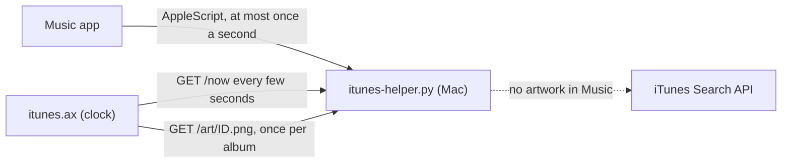

# awtrix-itunes

Shows the song playing in **Apple Music** (the app that used to be iTunes) on an
[AWTRIX NG](https://github.com/Blueforcer/awtrix-ng) clock: the album artwork, the title and
artist on two scrolling lines, and a progress bar. Built for the Ulanzi TC002 (52×16).


The AWTRIX Hub has several Spotify apps but nothing for Apple Music. Spotify has a web API the
clock can call itself. Apple Music has no API for what's playing on your Mac, so this comes in
two parts:

- **`itunes.ax`**: the clock script. All of its options are settings in the clock's web UI.
- **`itunes-helper.py`**: a small helper for the Mac. It asks the Music app what's playing and
  answers the clock over your local network.

This is an independent project, not affiliated with or endorsed by Apple or the AWTRIX project.

## Requirements

- An AWTRIX NG clock with a 52×16 display (Ulanzi TC002)
- A Mac with the Music app (macOS 10.15 or later) on the same network as the clock
- Python 3 on the Mac. If `python3 --version` asks you to install the command line developer
  tools, say yes. The helper needs nothing else.

## 1. Run the helper on the Mac

```sh
curl -O https://raw.githubusercontent.com/mojeska/awtrix-itunes/main/itunes-helper.py
python3 itunes-helper.py --install
```

`--install` copies the helper to `~/Library/Application Support/AWTRIX iTunes Helper/` and starts
it now and at every login. Its log is in the same folder. Two macOS prompts may come up:

- **"python3" wants to control "Music"**: allow it, or the helper can't see what's playing.
  (Changed your mind? System Settings > Privacy & Security > Automation.)
- **Accept incoming network connections**: allow it, or the clock can't reach the helper.

Check it from the Mac while a song plays:

```sh
curl http://localhost:8765/now
```

To try it without installing, run `python3 itunes-helper.py` and stop it with Ctrl-C.
`python3 itunes-helper.py --uninstall` removes it.

| Option | Default | What it does |
|---|---|---|
| `--port` | `8765` | The port the clock connects to |
| `--key` | none | A password the clock must send. Set the same **Helper key** on the clock |

Find the Mac's address under System Settings > Network, or with `ipconfig getifaddr en0`. Giving
the Mac a fixed address (a DHCP reservation in your router) saves fixing the setting later.

## 2. Install the script on the clock

In the clock's web UI, open **Scripts**, choose **Import**, pick `itunes.ax` and save. Or from a
computer:

```sh
curl -X PUT http://<clock-ip>/api/v1/apps/script/itunes \
  -H 'Content-Type: text/plain' --data-binary @itunes.ax
```

Then open **Apps**, click the gear next to **iTunes Now Playing**, enter the Mac's address and
save. A new script isn't in the rotation until you drag it into place on the Apps tab.

## Settings

| Setting | Default | |
|---|---|---|
| Mac address | (empty) | The Mac's IP or name. Until it's set, the app says "Set Mac address" |
| Helper port | 8765 | Same as the helper's `--port` |
| Helper key | (empty) | Same as the helper's `--key` |
| Check every | 3 s | How often the clock asks the Mac |
| When paused | hide | `hide` skips the app while nothing plays; `show` keeps it, greyed out |
| Album artwork | on | Off gives the text the full width |
| Progress bar | on | Along the bottom row |
| Show new songs at once | off | Jump to the app whenever a new song starts |
| Title / Artist / Progress colour | white / amber / white | |
| Scroll speed | 90% | 100% is the clock's normal speed |

## How it works



- The helper never starts Music. While Music is closed, stopped or paused, the app drops out of
  the rotation (unless **When paused** is `show`). The same happens when the Mac sleeps.
- Artwork comes from the track in Music, shrunk to 16×16. Streamed songs sometimes don't hand
  theirs over, so the helper then looks the album up on Apple's iTunes Search, and as a last
  resort shows a music note.
- Between checks, the progress bar moves on its own, so it stays smooth.

## Security

The helper answers two read-only requests, `/now` and `/art/<id>.png`, on your local network.
Anyone on that network can see what you're listening to, and nothing more. Request text is never
passed to AppleScript or a shell, and the helper can't control playback. Use `--key` if you
share your network with people you'd rather not tell. Don't forward the port to the internet.

## Troubleshooting

| Symptom | Check |
|---|---|
| The app never shows | Is a song playing? `curl http://<mac-ip>:8765/now` from another computer should say `"playing"`. Is the app in the rotation (Apps tab)? |
| `curl` works on the Mac but not from elsewhere | The macOS firewall: System Settings > Network > Firewall > Options, allow python3 |
| `/now` always says `"off"` | The helper isn't allowed to control Music. System Settings > Privacy & Security > Automation |
| "Set Mac address" on the clock | Enter the Mac's address in the app's settings |
| A grey square instead of artwork | The clock is still downloading it. If it stays grey, check the helper log |

## License

MIT. See [LICENSE](LICENSE).
