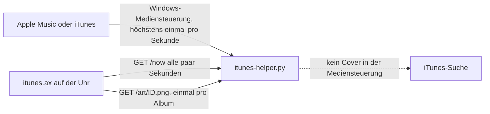

# AWTRIX Apple Music für Windows

Zeigt den Titel, der in **Apple Music** oder **iTunes** auf einem Windows-PC läuft, auf einer
[AWTRIX-NG](https://github.com/Blueforcer/awtrix-ng)-Uhr: das Cover links, Titel und Interpret
als Lauftext, darunter der Fortschritt. Gebaut für die Ulanzi TC002 (52×16).

Das ist der Windows-Port von [mojeska/awtrix-itunes](https://github.com/mojeska/awtrix-itunes)
von Jeff Rainey. Das Original fragt die Musik-App auf dem Mac per AppleScript. Unter Windows
gibt es das nicht. Apple Music und iTunes melden den laufenden Titel an die
Windows-Mediensteuerung, und dieser Helper liest genau dort. Die Uhr bekommt dieselben
Antworten wie beim Mac-Helper: `GET /now` und `GET /art/<id>.png`.

Eigenes Projekt, ohne Verbindung zu Apple oder zum AWTRIX-Projekt.

## Windows in fünf Schritten

Die Origin-Befehle (`curl … | sh`, `origin auth login`) gelten für Mac und Linux. Unter Windows funktionieren sie nicht.

1. Python von https://www.python.org/downloads/windows/ laden. Im Installer unten **Add python.exe to PATH** ankreuzen, dann **Install Now**.
2. [Git für Windows](https://git-scm.com/download/win) installieren. In der Eingabeaufforderung:

```bat
cd %USERPROFILE%
git clone https://github.com/Tixima/awtrix-applemusic-win.git
cd awtrix-applemusic-win
```
3. In dem Ordner **install.bat** doppelklicken. Das Fenster offen lassen, bis „Eingerichtet“ erscheint. Die angezeigte Adresse merken, zum Beispiel `192.168.1.20`. Wenn Windows nach der Firewall fragt: Zugriff zulassen.
4. In Apple Music oder iTunes einen Titel starten. Im Browser `http://localhost:8765/now` öffnen. Dort muss `"playing"` stehen.
5. Auf der Uhr **Skripte**, dann **Importieren**, die Datei `itunes.ax` wählen. Unter **Apps** beim Zahnrad von **Apple Music** die Adresse aus Schritt 3 eintragen und die App in die Rotation ziehen.

## Was du brauchst

- eine AWTRIX-NG-Uhr mit 52×16 (Ulanzi TC002), im selben Netz wie der PC
- Windows 10 oder 11
- Apple Music aus dem Microsoft Store, oder das klassische iTunes
- Python 3.10 oder neuer von [python.org](https://www.python.org/downloads/). Bei der
  Installation „Add python.exe to PATH“ ankreuzen.

## 1. Helper auf dem PC

Im Projektordner `install.bat` doppelklicken. Das installiert die Python-Pakete und trägt
den Helper in die Aufgabenplanung ein. Er läuft danach sofort und bei jeder Anmeldung,
ohne Konsolenfenster.

Zum Ausprobieren ohne Einrichtung, in einer Eingabeaufforderung im Projektordner:

```bat
py -3 -m pip install -r requirements.txt
py -3 itunes-helper.py
```

Beenden mit Strg-C. `uninstall.bat` nimmt den Autostart wieder weg.

Während ein Titel läuft, im Browser auf dem PC öffnen:

```text
http://localhost:8765/now
```

Dort steht `"s": "playing"`, dazu Titel, Interpret, Album, Position, Länge und der Pfad
zum Cover. `start.bat` macht dasselbe wie der Aufruf oben und lässt das Fenster offen.

| Option | Vorgabe | Bedeutung |
|---|---|---|
| `--port` | `8765` | Port, den die Uhr anspricht |
| `--key GEHEIM` | keiner | derselbe Text wie **Schlüssel** auf der Uhr |
| `--demo` | aus | festes Beispiel, damit die Uhr ohne Apple Music geprüft werden kann |

Die Adresse für die Uhr steht beim Start im Fenster (eine IPv4-Adresse, nicht
`127.0.0.1`). Sonst in der Eingabeaufforderung `ipconfig` und die Zeile „IPv4-Adresse“
der WLAN-Karte nehmen. Eine feste Adresse im Router (DHCP-Reservierung) erspart später
das Nachtragen.

Beim ersten Start fragt die Windows-Firewall. Für private Netze den Zugriff zulassen.
Der Helper startet Apple Music und iTunes nicht. Er liest nur mit und kann die
Wiedergabe nicht steuern.

## 2. Skript auf die Uhr

In der Weboberfläche der Uhr **Skripte** öffnen, **Importieren**, `itunes.ax` wählen und
speichern. Oder von einem Rechner im selben Netz:

```sh
curl -X PUT http://<uhr-ip>/api/v1/apps/script/itunes \
  -H 'Content-Type: text/plain' --data-binary @itunes.ax
```

Danach unter **Apps** das Zahnrad bei **Apple Music**, die PC-Adresse eintragen und
speichern. Ein neues Skript erscheint in der Rotation erst, wenn es auf der Apps-Seite
an die gewünschte Stelle gezogen wird. Solange die Adresse fehlt, zeigt die Uhr
„Adresse / eintragen“.

## Einstellungen auf der Uhr

| Einstellung | Vorgabe | |
|---|---|---|
| PC-Adresse | leer | IP oder Name des PCs |
| Port | 8765 | derselbe Wert wie `--port` |
| Schlüssel | leer | derselbe Wert wie `--key` |
| Intervall | 3 s | wie oft die Uhr nachfragt |
| Bei Pause | ausblenden | `anzeigen` lässt die App stehen, grau |
| Albumcover | an | aus nutzt die ganze Breite für den Text |
| Fortschritt | an | Balken in der unteren Zeile |
| Neue Titel sofort | aus | springt zur App, wenn ein anderer Titel beginnt |
| Titelfarbe / Interpretfarbe / Balkenfarbe | weiß / amber / weiß | |
| Lauftext | 90 % | 100 % ist die normale Geschwindigkeit der Uhr |

## Ablauf



- Läuft nichts, ist die App zu, oder der PC schläft, fällt die App aus der Rotation
  (außer **Bei Pause** steht auf `anzeigen`).
- Das Cover kommt von der Windows-Mediensteuerung und wird auf 16×16 verkleinert.
  Gestreamte Titel geben es manchmal nicht her. Dann sucht der Helper das Album über
  die iTunes-Suche, und wenn auch das nichts findet, zeigt er eine Note.
- Zwischen zwei Abfragen läuft der Balken auf der Uhr von allein weiter.

Klassisches iTunes, das in der Mediensteuerung nicht auftaucht, wird zusätzlich über die
alte iTunes-Schnittstelle gelesen, und auch dort nur, wenn iTunes schon läuft.

## Sicherheit

Der Helper beantwortet im lokalen Netz nur `/now` und `/art/<id>.png`. Wer im selben
Netz ist, sieht den laufenden Titel und sonst nichts. Der angeforderte Pfad wird nicht
an eine Shell oder an iTunes weitergereicht. Mit `--key` bleibt der Titel für andere
im Netz unsichtbar. Den Port nicht aus dem Internet hereingeben. Der Schlüssel darf
kein Leerzeichen und keines der Zeichen `&`, `?` und `#` enthalten, weil die Uhr ihn
in die Adresse setzt.

## Wenn etwas nicht stimmt

| Was du siehst | Was du prüfst |
|---|---|
| Die App kommt nie | Läuft ein Titel? `http://<pc-ip>:8765/now` von einem anderen Gerät muss `"playing"` sagen. Liegt die App in der Rotation? |
| Auf dem PC geht die Seite, von der Uhr nicht | Firewall: beim ersten Start den Zugriff zugelassen? Sonst die Eingabeaufforderung als Administrator und `netsh advfirewall firewall add rule name="AWTRIX Apple Music" dir=in action=allow protocol=TCP localport=8765` |
| `/now` sagt immer `"off"` | Zeigt die Lautstärke-Ansicht von Windows den Titel? Wenn nicht, sieht auch der Helper ihn nicht. Apple Music muss laufen und etwas abspielen. Im Protokoll `helper.log` steht, welche Sitzungen Windows meldet. |
| „Adresse / eintragen“ | PC-Adresse in den Einstellungen der App eintragen |
| „Datei nicht gefunden“ und danach „Zugriff verweigert“ | Die ersten beiden Zeilen heißen nur: die Aufgabe gab es noch nicht. „Zugriff verweigert“ heißt, Windows will den Eintrag nicht ohne Administrator. Rechtsklick auf `install.bat`, **Als Administrator ausführen**. Danach muss „Eingerichtet“ stehen. |
| Graues Quadrat statt Cover | Die Uhr lädt das Bild noch. Bleibt es grau, ins Protokoll schauen. |
| Interpret heißt „Name - Album“ | Apple Music liefert die Felder manchmal so. Der Helper trennt das, wenn das Album hinten steht. |

Nach `--install` liegt das Protokoll unter
`%LOCALAPPDATA%\AWTRIX Apple Music Helper\helper.log`.

## Tests

```bat
py -3 -m pip install -r requirements-dev.txt
py -3 -m pytest
```

Die Tests laufen auch ohne Windows. Sie prüfen das Uhr-Protokoll, die Sitzungswahl,
die Cover und die Aufgabenplanung. Die echten Windows-Aufrufe bleiben in
`windows_smtc.py` und werden dort nur zusammengesetzt.

## Lizenz

MIT. Der Hinweis von Jeff Rainey steht in [LICENSE](LICENSE).
